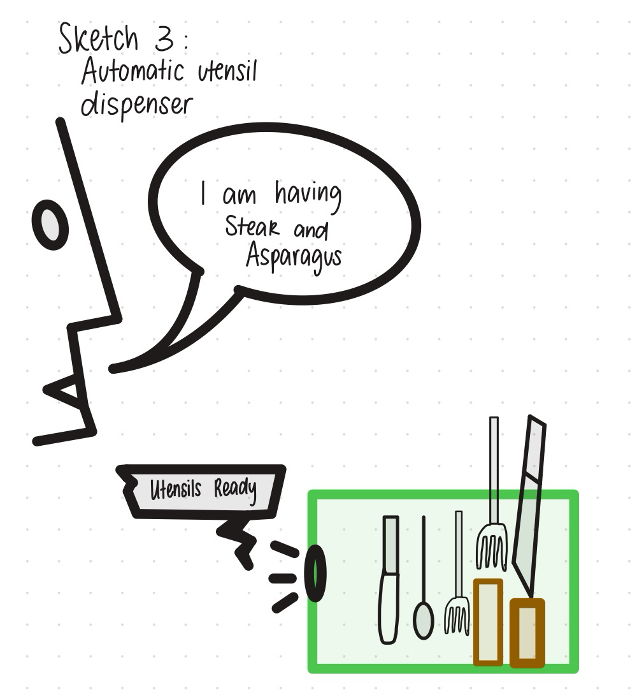
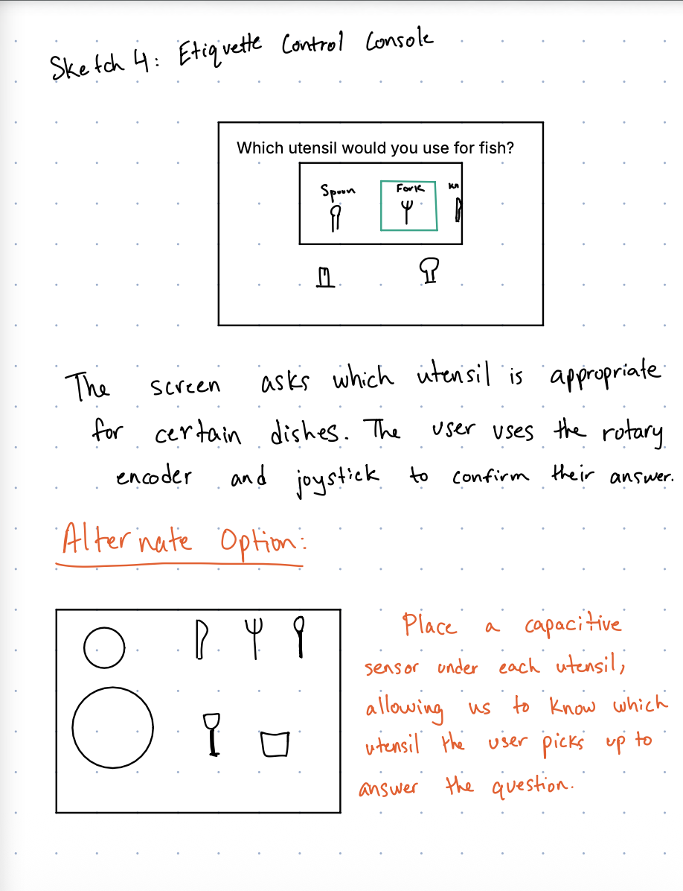
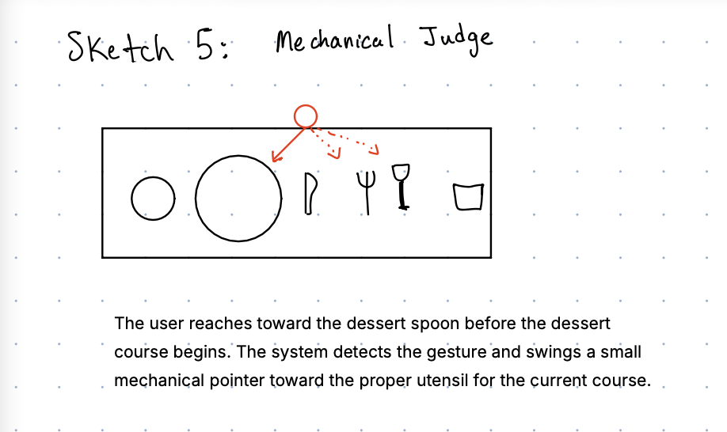

# Ph-UI!!!

	
<strong>Instructions for Students (Click to Expand)</strong>

  
	**Submission Cleanup Reminder:**
	- This README.md contains extra instructional text for guidance.
	- Before submitting, remove all instructional text and example prompts from this file.
	- You may delete these sections or use the toggle/hide feature in VS Code to collapse them for a cleaner look.
	- Your final submission should be neat, focused on your own work, and easy to read for grading.
  
	This helps ensure your README.md is clear, professional, and uniquely yours!

---

---

## Lab Overview
Team: <canvas group name>  
Members: Ani Hadagali, Jon Tumalle 
Project name: Fine Dining Etiquette 

For lab this week, we focus on both sensing and actuation, bringing new modes of input and output into your devices, while also prototyping the physical structure and overall look of the device. You will consider how the physical form supports sensing and actuation, and how these elements come together to shape the interaction and aesthetics of the device.

---

## Lab Structure

A) [Capacitive Sensing](#part-a)

B) [More Sensors](#part-b)

C) [Servo Actuation](#part-c)

D) [Physical Interaction Design: Feast Automata](#part-d)

E) [Build & Integrate](#part-e)

F) [Final Documentation](#part-f)

---

## Part 1 Lab Preparation

### Part A
### Capacitive Sensing, a.k.a. Human-Twizzler Interaction 

### Part B
### More sensors

### Part C
### Servo Actuation

### Part D
### Physical Interaction Design: Feast Automata

**Feast Automata:** build a device that **transforms ordinary dining rituals into playful physical interactions.** Begin with a familiar experience around eating, drinking, cooking, serving, or sharing food, and explore how sensing and actuation might augment, exaggerate, automate, or reinterpret your dining experience.

In this part, use the sensing techniques from Parts A–B and the servo actuation from Part C to develop a physical interaction.

**\*\*\*Draw 5 sketches that explore different physical arrangements for your sensing and actuation.\*\*\***

**\*\*\*What questions do these sketches raise? What do you need to physically prototype to answer them?\*\*\***

Some questions came up include:

- If we went with the automatic dispenser idea, how would it dispense the utensils? How would we know it's strong enough to lift them up in a safe way?
	- For this we would need to simulate the dispensing. We could add weights to a platform the motor can push up and experiment to see what the limit is and compare it to the average weight of the most heavy utensil.
- For sketch 5, how would we know the motor can move to an angle that actually points to the correct object? Would we need a more precise motor than what we have available?
	- For this we could set up two utensils next to each other (a fork and a spoon) as they would in a regular table setting and see if we can utelize computer vision to determine there are 2 utensils.
- For using the sensors, how would we hide the connection to the sensors so that it isn't distracting from how it should be used?
	- We could prototype the system with just one fake paper utensil to see if we can hide the wiring.
- When we fix the number of utensils we allow the user to use, how do we know that we cover all the cases seen in the "fine dining" world?
	- This is not something physical prototyping can address since this is more of a hypothetical.
- How will the system determine whether a utensil has been placed in the correct position?
	- We could place capacitive sensors beneath designated table positions and test whether they can detect a utensil being placed or removed. We could try different sensor positions and materials between the sensor and utensil to determine how reliably the system detects placement.
- How will the system distinguish between different utensils placed in the same location?
	- We could test whether capacitive sensing can distinguish a fork from a spoon or whether we need separate designated placement zones. We could also experiment with identifying utensils through their shape or by attaching small markers, if appropriate.		
- How do we prevent the sensors from detecting a utensil that is near a position but not actually placed there?
	- We could move utensils around the edges of each sensing zone and test when the sensor activates. This would help us determine the appropriate size and spacing of each zone.
- How can we avoid forcing the user to constantly look between the phone and the table?
	- We could prototype alternative feedback methods, such as highlighting the next position on the phone while using a physical indicator or OLED at the table. We could then compare how easily users follow the instructions.
- How do we know the system has correctly detected the user's action?
	- We could test a series of known actions, such as picking up a fork, moving a spoon, or placing a knife down. We could compare the system's detected actions with what actually happened and record how often it makes mistakes.
- How long can the user wait between performing an action and receiving feedback?
	- We could measure the time between a sensor detecting an action and the display or servo responding. We could test different delays and observe whether the interaction feels immediate enough.

**\*\*\*Pick one design to prototype and explain why.\*\*\***

The user sits down at a simulated dining table. A screen displays a dish, such as soup, and asks the user to select the correct utensil. The user picks up a paper fork, knife, or spoon from the table setting. The system tells them whether their choice is correct and explains the appropriate etiquette.

I'd choose this design because it combines physical interaction, sensing, and feedback in a simple experience. It also lets you test the core idea before investing time in building the dispenser or integrating real sensors.

**\*\*\*Document your rough prototype with photos and/or video.\*\*\***

---

## Part 2

Following exploration and reflection from Part 1, complete the "looks like," "works like" and "acts like" prototypes for your design, reiterated below.

---

### Part E

#### Build & Integrate: Sensing + Actuation

For Part 2, build the Feast Automata interaction you developed in Part D by connecting sensing/input to physical actuation.

**Your prototype should:**
- Use at least one sensing or input device.
- Use servo-based physical actuation.
- Connect sensing and actuation into a meaningful interaction around eating, drinking, cooking, serving, or sharing food.
- Additional inputs, displays, LEDs, buttons, or other outputs are optional extensions.

**Document your system with:**
- Code for your sensing + actuation prototype
- Photos and/or video of the working prototype in action
- A simple interaction diagram or sketch showing how sensing and actuation are connected
- Written reflection: What did you learn about connecting sensing, movement, and physical form? What was fun, surprising, or challenging?

**Questions to consider:**
- How does your chosen sensor or input shape the physical response?
- How does the physical arrangement of the sensor and actuator change the interaction?
- What thresholds, timing, or movement patterns make the interaction feel clear or playful?
- What changes when you adjust the sensor placement or servo motion?

Iterate on the sensing, movement, and physical form, and document what you discover.

See encoder_accel_servo_dashboard.py in the Lab 4 folder for an optional example of chaining together three devices.

**`Lab 4/encoder_accel_servo_dashboard.py`**

### Part F

### Final Documentation

Document all the prototypes and iterations you have designed and worked on! Again, deliverables for this lab are writings, sketches, photos, and videos that show what your prototype:
* "Looks like": shows how the device should look, feel, sit, weigh, etc.
* "Works like": shows what the device can do
* "Acts like": shows how a person would interact with the device

---

## Deliverables \& Submission for Lab 4

The deliverables for this lab are, writings, sketches, photos, and videos that show what your prototype:
* "Looks like": shows how the device should look, feel, sit, weigh, etc.
* "Works like": shows what the device can do.
* "Acts like": shows how a person would interact with the device.

For submission, the readme.md page for this lab should be edited to include the work you have done:
* Upload any materials that explain what you did, into your lab 4 repository, and link them in your lab 4 readme.md.
* Link your Lab 4 readme.md in your main Interactive-Lab-Hub readme.md. 
* Labs are due on Mondays, make sure to submit your Lab 4 readme.md to Canvas.
